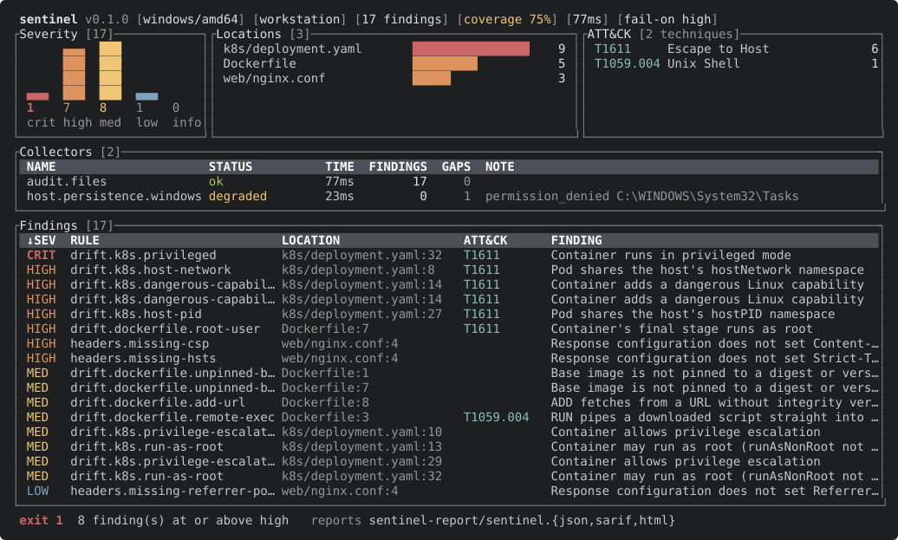

# sentineltriage

[](https://github.com/codext4fn-afk/sentineltriage/actions/workflows/ci.yml)
[](go.mod)
[](LICENSE)

`sentinel` audits infrastructure-as-code for insecure settings and inspects a host's autostart configuration for persistence. Findings are mapped to MITRE ATT&CK and written as JSON, SARIF 2.1.0, and a standalone HTML report. The exit code is meant to fail a CI job.

<p align="center">
  
</p>

- **Audit engine:** Dockerfiles, Kubernetes manifests, and web server header configuration.
- **Host engine:** Run keys, Winlogon, Startup folders, scheduled tasks, and services on Windows; `ld.so.preload`, cron, and systemd on Linux. Can also audit a mounted Linux filesystem offline.
- **Output:** terminal dashboard, interactive TUI (`-i`), JSON, SARIF for GitHub code scanning, self-contained HTML.
- **Single static binary**, no cgo. Reads configuration only, never process memory or environment.

## Installation

Prebuilt binaries for Linux, macOS, Windows, and FreeBSD are on the [releases page](https://github.com/codext4fn-afk/sentineltriage/releases). Each release includes `checksums.txt` and a build provenance attestation:

```sh
gh attestation verify sentinel_<version>_linux_amd64.tar.gz --repo codext4fn-afk/sentineltriage
```

With Go 1.26 or later:

```sh
go install github.com/codext4fn-afk/sentineltriage/cmd/sentinel@latest
```

From source:

```sh
git clone https://github.com/codext4fn-afk/sentineltriage
cd sentineltriage
CGO_ENABLED=0 go build -trimpath -ldflags "-s -w" -o sentinel ./cmd/sentinel
```

Builds for Linux, macOS, Windows, and FreeBSD on amd64 and arm64.

## Usage

```sh
sentinel                          # audit ./ and triage this host
sentinel --engine audit ./infra   # audit only
sentinel -i                       # interactive view
sentinel --fail-on medium         # stricter gate
sentinel -f json | jq '.findings[] | select(.severity == "critical")'
sentinel --engine host --host-root /mnt/image   # offline triage of a mounted Linux disk
```

Reports go to `sentinel-report/` by default (`sentinel.json`, `sentinel.sarif`, `sentinel.html`). Use `-r` to choose formats and `-o` to change the directory.

<details>
<summary><code>sentinel --help</code></summary>

```
Usage: sentinel [OPTION]... [PATH]...
Triage the local host and audit each PATH (default ".") for security issues.

Options:
  -c, --config FILE                  load configuration from FILE
  -e, --engine strings               engines to run: host, audit, all (repeatable)
      --fail-on SEVERITY             exit 1 on findings at or above SEVERITY (info|low|medium|high|critical)
      --min-coverage RATIO           exit 4 when collector coverage is below RATIO (0-1)
  -t, --timeout duration             global time budget for the run (default 10s)
      --collector-timeout duration   per-collector time limit (default: --timeout)
  -j, --jobs int                     collectors to run in parallel (default: CPU count)
  -o, --output-dir DIR               write reports into DIR (default sentinel-report)
  -r, --report strings               report formats: json, sarif, html, none (repeatable)
      --sarif-include-host           include host-engine findings in the SARIF file
  -f, --format string                stdout format: summary, json, none (default "summary")
      --host-root DIR                audit a mounted Linux filesystem at DIR instead of the live host
      --max-file-bytes N             skip audited files larger than N bytes
      --log-level string             diagnostic log level: debug, info, warn, error (default "warn")
      --log-format string            diagnostic log format on stderr: auto, text, json (default "auto")
  -q, --quiet                        suppress progress and summary output
      --color string                 colorize output: auto, always, never (auto honours NO_COLOR) (default "auto")
      --no-color                     same as --color=never
  -i, --tui                          interactive full-screen view (requires a terminal)
      --print-config                 print the effective configuration and exit
  -V, --version                      print version information and exit
  -h, --help                         show this help and exit
```

</details>

### Interactive view

`sentinel -i` opens a full-screen view with the same layout. Keys: `↑`/`↓` or `j`/`k` to move, `,` and `.` to change the sort column, `/` to reverse it, `f` to cycle the severity filter, `q` to quit. Quitting before the scan finishes cancels it and still writes a partial report.

### Exit codes

| Code | Meaning |
|-----:|---------|
| 0 | No findings at or above `--fail-on` (default `high`) |
| 1 | Findings at or above `--fail-on` |
| 2 | Invalid flags, configuration, or host root |
| 3 | Nothing was observed, or a report could not be written |
| 4 | Coverage below `--min-coverage` (opt-in) |
| 130 | Interrupted. A partial report marked `interrupted` is still written |

A run that observes nothing exits 3, not 0, so a misconfigured scanner cannot pass a gate.

## CI

GitHub Actions with code scanning:

```yaml
- run: go install github.com/codext4fn-afk/sentineltriage/cmd/sentinel@latest
- run: sentinel --engine audit -r sarif -o sentinel-report .
- uses: github/codeql-action/upload-sarif@v3
  if: always()
  with:
    sarif_file: sentinel-report/sentinel.sarif
```

SARIF results carry `security-severity` scores, so GitHub ranks them as critical, high, medium, or low. Host findings are left out of SARIF unless `--sarif-include-host` is set, since code scanning is organized around repository files.

## Checks

### Audit engine

| Rule | Severity | Detects | ATT&CK |
|---|---|---|---|
| `drift.dockerfile.unpinned-base` | medium | `FROM` with no tag or the `latest` tag (digest-pinned images pass) | |
| `drift.dockerfile.add-url` | medium | `ADD` from a remote URL | |
| `drift.dockerfile.remote-exec` | medium | `curl`/`wget` piped into a shell | T1059.004 |
| `drift.dockerfile.root-user` | high | Final stage has no non-root `USER` | T1611 |
| `drift.k8s.privileged` | critical | `privileged: true` | T1611 |
| `drift.k8s.host-pid` / `host-network` / `host-ipc` | high | Pod shares a host namespace | T1611 |
| `drift.k8s.dangerous-capability` | high | Adds `SYS_ADMIN`, `NET_ADMIN`, `SYS_PTRACE`, `ALL`, ... | T1611 |
| `drift.k8s.run-as-root` | medium | `runAsNonRoot` unset and no non-zero `runAsUser` | |
| `drift.k8s.privilege-escalation` | medium | `allowPrivilegeEscalation` unset or true | |
| `headers.missing-csp` | high | No `Content-Security-Policy` | |
| `headers.missing-hsts` | high | No `Strict-Transport-Security` | |
| `headers.missing-nosniff` | medium | No `X-Content-Type-Options` | |
| `headers.missing-frame-options` | medium | No `X-Frame-Options` or CSP `frame-ancestors` | |
| `headers.missing-referrer-policy` | low | No `Referrer-Policy` | |

Kubernetes checks cover Pod, Deployment, StatefulSet, DaemonSet, ReplicaSet, Job, CronJob, and ReplicationController, including multi-document files. Header checks run on Netlify `_headers` and `netlify.toml`, `vercel.json`, and on nginx and Apache configuration and `.htaccess` files that already set response headers.

### Host engine: Windows

| Rule | Severity | Detects | ATT&CK |
|---|---|---|---|
| `host.persistence.run-key-suspicious` | medium/high | Run or RunOnce value that runs encoded or hidden PowerShell, mshta, a regsvr32 scriptlet, rundll32 script, or a binary in a user-writable directory | T1547.001 |
| `host.persistence.winlogon-modified` | high | `Userinit` or `Shell` launches anything besides `userinit.exe` / `explorer.exe` | T1547.004 |
| `host.persistence.startup-file` | medium | Script or executable in a Startup folder instead of a shortcut | T1547.001 |
| `host.persistence.service-suspicious` | high | Service `ImagePath` matches the patterns above | T1543.003 |
| `host.persistence.service-unquoted-path` | medium | Unquoted `ImagePath` with spaces | T1574.009 |
| `host.persistence.task-suspicious` | medium/high | Scheduled task action matches the patterns above | T1053.005 |

Run keys are read from HKLM, HKCU, and the WOW6432Node view. Reading `System32\Tasks` requires administrator rights; without them it is reported as a `permission_denied` gap and the other locations are still checked.

### Host engine: Linux

| Rule | Severity | Detects | ATT&CK |
|---|---|---|---|
| `host.persistence.ld-preload` | high | Entries in `/etc/ld.so.preload` | T1574.006 |
| `host.persistence.cron-temp-exec` | medium | Cron job runs from `/tmp`, `/var/tmp`, or `/dev/shm` | T1053.003 |
| `host.persistence.cron-writable` | medium | Cron file writable by group or others | T1053.003 |
| `host.persistence.unit-temp-exec` | medium | systemd `Exec*` from a temp directory | T1543.002, T1053.006 |
| `host.persistence.unit-writable` | medium | systemd unit or timer writable by group or others | T1543.002, T1053.006 |

ATT&CK IDs are validated at runtime against a table pinned to ATT&CK Enterprise v18. A finding that cites an unknown ID is rejected.

## Coverage

Each collector reports a status (`ok`, `degraded`, `timeout`, `failed`, `unsupported`, ...) and the locations it could not read. Coverage is the weighted share of collectors that completed: `ok` counts 1, `degraded` 0.5, anything else 0, and `unsupported` is excluded. An empty result is only meaningful next to that list, so both appear in every output format. `--min-coverage` turns low coverage into exit code 4.

## Configuration

```yaml
version: 1
budget: 10s
fail_on: high
engines:
  audit:
    paths: ["."]
    exclude: ["**/*.min.js", "testdata"]
output:
  dir: sentinel-report
  formats: [json, sarif, html]
```

The full schema is in [`sentinel.example.yaml`](sentinel.example.yaml). Configuration is loaded only from `--config`. It is never picked up from the scanned directory, because a repository under audit could otherwise ship a file that disables its own checks. Unknown keys are an error.

## Benchmarks

| Workload | Files in tree | Files opened | Median wall time | Peak RSS |
|---|---:|---:|---:|---:|
| `--engine audit` on the Go 1.27.0 install directory | 15,636 | 67 | 175 ms | 16 MB |
| `--engine host` on Windows 11 | n/a | n/a | 31 ms | n/a |

AMD Ryzen 5 5600X (12 threads), Windows 11 Pro, Go 1.27.0. Median of five runs with a warm file cache, measured end to end including process startup.

Analyzers decide from the path whether they want a file, so files no analyzer handles are never opened. The first 8 KiB of a selected file are checked for NUL bytes before the rest is read.

## Design

See [docs/architecture.md](docs/architecture.md) for scheduling, failure isolation, fingerprinting, and the HTML report's security model. In short:

- Every collector runs in its own goroutine behind `recover()` and a deadline. A collector that ignores cancellation is abandoned at the deadline and its partial output kept.
- Findings are copied and validated at the engine boundary, then sorted and de-duplicated by a line-independent fingerprint, so ordering is stable and a finding keeps its identity when code above it moves.
- Reports are written to a temp file and renamed, with mode `0600`.
- The HTML report makes no network requests. Finding data is rendered with `textContent`, and the script and stylesheet are pinned by hash in a `default-src 'none'` CSP.

## Limitations

- Secret scanning is out of scope. Run [gitleaks](https://github.com/gitleaks/gitleaks) or [trufflehog](https://github.com/trufflesecurity/trufflehog) as a separate step and upload both SARIF files.
- The host engine has no macOS collector yet. On macOS it reports an `unsupported` gap.
- Windows Startup folders are read for the current user and all users, not for every profile on the machine.
- Header checks are static. They cannot see headers added by a CDN, load balancer, or application code.

## Development

```sh
go test ./...
go test -race ./...    # requires cgo
go vet ./...
```

CI runs tests with the race detector on Linux, macOS, and Windows, plus `govulncheck` and a cross-compile matrix.

## License

[MIT](LICENSE)
