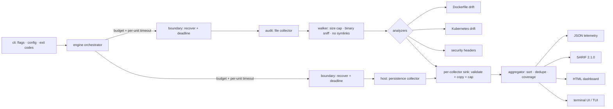
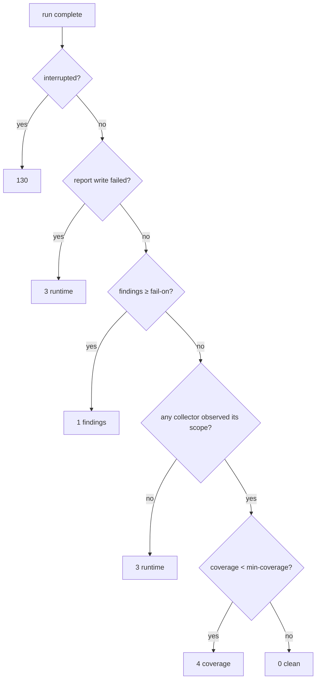

# SentinelTriage

A lightweight, dependency-light CLI for **DevSecOps auditing** and **Linux host persistence triage**. It walks a repository for infrastructure-as-code misconfigurations and missing HTTP security headers, inspects a Linux host's persistence configuration, maps findings to **MITRE ATT&CK**, and emits machine-readable **JSON**, GitHub-compatible **SARIF 2.1.0**, and a self-contained **HTML** dashboard — with an exit-code contract designed to gate CI/CD pipelines.

> **Scope and intent.** SentinelTriage is a defensive auditing tool. It reads *configuration*: repository files and Linux system config (cron, systemd, `ld.so.preload`). It does **not** read other processes' memory or environment variables, and it ships **no credential-extraction rules**. For secret scanning, run a dedicated scanner (gitleaks, trufflehog) as a separate pipeline step and merge its SARIF alongside this tool's output.

---

## Highlights

- **Failure-isolated engine.** Every collector runs inside a recovery boundary with its own deadline. A panicking or hung collector cannot crash the run or block its siblings; its partial results are sealed and the gap is recorded.
- **Honest coverage.** A permission-denied path is reported as a *coverage gap*, not silence. Absence of findings is only meaningful next to the list of what could not be examined.
- **Deterministic output.** Findings are sorted and de-duplicated by a line-stable fingerprint, so SARIF and JSON diffs in review reflect real changes, not reordering.
- **CI-first exit codes.** Distinct codes for "findings", "usage error", "runtime failure", and "coverage too low" — a broken scanner never masquerades as a passing gate.
- **Self-contained reports.** The HTML dashboard inlines all CSS/JS and ships a strict, hash-pinned Content-Security-Policy; no external resources, no network.
- **Minimal supply chain.** The default binary depends on two zero-to-few-dependency modules. The Bubble Tea live view and its tree are opt-in behind `-tags tui`.

---

## Architecture



### Concurrency and failure isolation

```mermaid
sequenceDiagram
    participant O as Orchestrator
    participant G as Collector goroutine
    participant S as Sealed buffer
    O->>O: ctx = WithTimeout(budget)
    O->>G: run(unit) with per-unit deadline + recover()
    G-->>S: Emit() findings (copied, validated, capped)
    alt finishes in time
        G-->>O: nil / error
    else exceeds deadline
        O->>G: cancel; wait grace period
        O->>S: seal() — later Emits discarded
        Note over O,G: uncooperative goroutine is abandoned, not awaited
    end
    O->>O: aggregate → sort → dedupe → coverage
```

### Exit-code decision



---

## Install & build

```bash
# Standard binary (no TUI dependencies)
go build -o sentinel ./cmd/sentinel

# With the interactive Bubble Tea live view
go build -tags tui -o sentinel ./cmd/sentinel

# Reproducible, stripped, static (no cgo)
CGO_ENABLED=0 go build -trimpath -ldflags "-s -w" -o sentinel ./cmd/sentinel
```

Requires Go 1.25+. Builds for linux, darwin, windows, and freebsd on amd64/arm64.

---

## Usage

```bash
# Audit the current repository and triage the host
sentinel

# Audit only, fail the build on High or Critical (default threshold)
sentinel --engine audit ./infra

# Stricter gate, machine-readable stdout
sentinel --fail-on medium --format json > findings.json

# Write all three report formats to a directory
sentinel --report json --report sarif --report html --output-dir sentinel-report
```

### Exit-code matrix

| Code | Meaning |
|-----:|---------|
| `0` | No findings at or above `--fail-on` |
| `1` | Findings at or above `--fail-on` (default `high`) |
| `2` | Usage, configuration, or rules error |
| `3` | Runtime failure: nothing observed, or a report could not be written |
| `4` | Coverage below `--min-coverage` (opt-in) |
| `130` | Interrupted (SIGINT) — a partial report is still written |

### GitHub Actions

```yaml
- name: SentinelTriage audit
  run: sentinel --engine audit --report sarif --output-dir sentinel-report .
- name: Upload SARIF
  if: always()
  uses: github/codeql-action/upload-sarif@v3
  with:
    sarif_file: sentinel-report/sentinel.sarif
```

---

## What it checks

### DevSecOps audit (cross-platform)

| Analyzer | Examples | ATT&CK |
|---|---|---|
| Dockerfile drift | unpinned base image, `ADD` from URL, `curl \| sh`, final stage runs as root | T1059.004, T1611 |
| Kubernetes drift | `privileged`, `hostPID/Network/IPC`, `runAsNonRoot` unset, dangerous capabilities | T1611 |
| Security headers | missing CSP, HSTS, `X-Content-Type-Options`, frame protection, `Referrer-Policy` | — |

### Host triage (Linux; other platforms report an explicit coverage gap)

| Analyzer | Examples | ATT&CK |
|---|---|---|
| `ld.so.preload` | a library injected into every process | T1574.006 |
| cron | world-writable cron files; jobs executing from `/tmp`, `/dev/shm`, `/var/tmp` | T1053.003 |
| systemd | world-writable units; `ExecStart` from staging paths; timers | T1543.002, T1053.006 |

ATT&CK technique IDs are validated at runtime against a curated table (`internal/attack`) pinned to a specific ATT&CK release, which is stamped into every report. A finding citing an unknown ID is rejected rather than published.

---

## Self-evaluation matrix

Scored 1–5 per criterion. `v0` is the honest first-draft design; `v1` is what shipped, after the hardening changes described in the project history.

| # | Criterion | v0 | v1 | Key change |
|---|---|:-:|:-:|---|
| 1 | Static/dynamic typing consistency | 4 | 5 | Severity, confidence, status, engine, exit code are typed enums with text (un)marshalers |
| 2 | Memory footprint | 3 | 4 | Per-file size cap + truncation; bounded worker queue; per-collector finding cap |
| 3 | Concurrency safety | 4 | 5 | Single-owner aggregator; per-collector buffered sink; `-race` in CI; deep-copy on emit |
| 4 | Error isolation | 3 | 5 | Per-collector `recover()` + deadline; abandon (not await) uncooperative goroutines |
| 5 | ATT&CK mapping accuracy | 3 | 4 | Central validated table, release-pinned; parent-fallback policy; confidence on every finding |
| 6 | SARIF compliance | 3 | 5 | Typed 2.1.0 model; validated against the **official schema** in tests; `security-severity`, fingerprints, `uriBaseId` |
| 7 | CI exit codes | 3 | 5 | Six distinct codes; findings never conflated with runtime failure |
| 8 | Regex/entropy performance | 3 | 4 | Analyzer `Applies` pre-filter; linear-time Go regex; parallel file workers |
| 9 | False-positive mitigation | 3 | 4 | Header checks only on files that set headers; K8s ignores non-manifest YAML; `frame-ancestors` satisfies frame-options |
| 10 | Dependency minimization | 2 | 4 | 2 runtime deps in the default build; TUI + its tree behind `-tags tui` |
| 11 | Config decoupling | 4 | 5 | Strict YAML (`KnownFields`); no implicit config discovery from the scanned tree |
| 12 | Log routing | 2 | 5 | `slog` to stderr; stdout carries report only; verified by test |
| 13 | Cross-platform portability | 2 | 4 | Audit engine fully portable; host engine build-tagged with an unsupported stub elsewhere |
| 14 | POSIX flags | 4 | 5 | `pflag`: bundling, `--` terminator, `NO_COLOR`, stdout/stderr separation |
| 15 | Signal handling | 2 | 5 | `NotifyContext`; partial report flagged `interrupted`; second Ctrl+C forces exit; atomic writes |
| 16 | Extensibility | 3 | 4 | Two-method `Analyzer` and `Collector` interfaces; shared finding builder |
| 17 | Low-privilege behavior | 3 | 4 | Permission → coverage gap; ENOENT treated as a benign race, not a gap |
| 18 | Documentation | 3 | 4 | Mermaid data-flow, concurrency, and exit-code diagrams; this matrix |
| 19 | Testability | 4 | 5 | `fs.FS`-injected host root; `testing/synctest` for deterministic timeouts; schema-validated SARIF |
| 20 | Self-contained HTML | 4 | 5 | Inlined assets; hash-pinned CSP `default-src 'none'`; DOM built via `textContent`, never `innerHTML` |
| | **Total** | **60** | **91** | |

### Honest caveats

- **v1 scores are a design self-assessment, not an external audit.** They are the project's own rubric.
- The **host engine is Linux-only.** Windows and macOS persistence collectors are on the roadmap; today they report an explicit `unsupported` coverage gap.
- The **race detector runs in CI**, not in every local build (it needs a C toolchain).
- The schema-validator test dependency (`santhosh-tekuri/jsonschema`) pulls in `golang.org/x/text`; it is **test-only** and not linked into any binary.

---

## Dependencies

| Module | Scope | Why |
|---|---|---|
| `github.com/spf13/pflag` | runtime | POSIX/GNU flags |
| `go.yaml.in/yaml/v3` | runtime | Kubernetes/Compose parsing |
| `github.com/charmbracelet/bubbletea`, `lipgloss` | runtime, `-tags tui` only | interactive live view |
| `github.com/santhosh-tekuri/jsonschema/v6` | **test only** | validates SARIF against the official 2.1.0 schema |

---

## Development

```bash
go test ./...                 # unit tests
go test -race -count=1 ./...   # with the race detector (needs cgo)
go test -tags tui ./internal/ui/
go vet ./...
gofmt -l .
```

### Layout

```
cmd/sentinel         entry point: signals, exit code
internal/engine      orchestration, failure boundary, aggregator, coverage
internal/finding     immutable finding model, severity/confidence, redaction, fingerprints
internal/attack      curated, validated MITRE ATT&CK table
internal/config      strict YAML config loader
internal/cli         flags, exit-code matrix, report wiring, logging
internal/audit       walker + analyzers (dockerfile, kubernetes, headers) + collector
internal/host/…      host persistence collector (Linux build-tagged)
internal/report/…    json, sarif, html writers + atomic file writer
internal/ui          plain renderer; Bubble Tea TUI behind -tags tui
```

---

## License

MIT. See [LICENSE](LICENSE).
