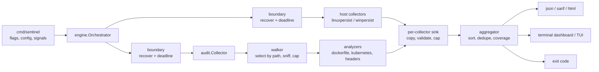
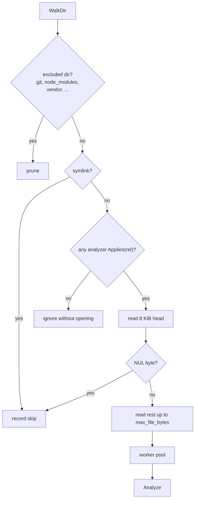
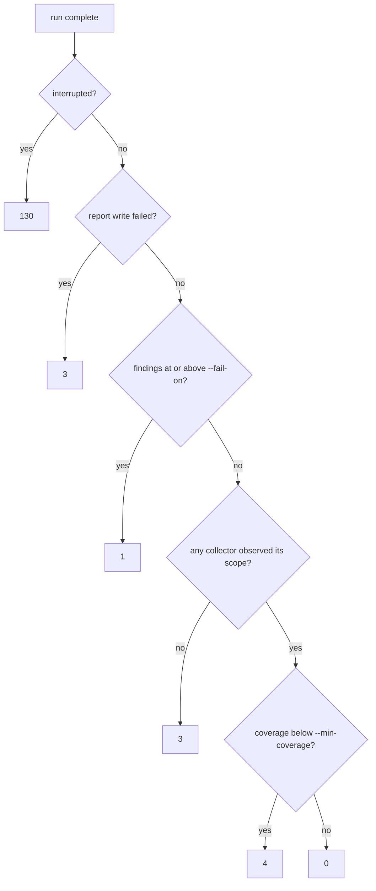

# Architecture

This document describes how a run is scheduled, how failures are contained, and how results become reports. It is aimed at contributors; see the [README](../README.md) for usage.

## Data flow



The CLI resolves configuration (defaults, then `--config`, then flags), builds the collectors for the enabled engines, and hands them to the orchestrator. Reports and the exit code are derived from a single `engine.Result`.

## Scheduling and failure isolation

Every collector runs on its own goroutine inside a boundary that recovers panics and enforces a deadline. A `recover()` in `main` cannot catch a panic raised on another goroutine, so the boundary is per collector.

```mermaid
sequenceDiagram
    participant O as Orchestrator
    participant G as Collector goroutine
    participant S as Sink
    O->>O: budget ctx (default 10s)
    O->>G: Run(ctx) with per-collector deadline
    G-->>S: Emit / Degrade
    alt returns in time
        G-->>O: nil or error
    else deadline passes
        O->>G: cancel, wait grace (250ms)
        O->>S: seal; later emits are dropped
        Note over O,G: a goroutine stuck in an uninterruptible read is abandoned, not awaited
    end
    O->>O: aggregate
```

Cancellation in Go is cooperative. A collector blocked in a read that ignores its context cannot be stopped, only abandoned. Its output is sealed at the deadline, the result is marked `timeout`, and the run proceeds. The goroutine's completion channel is buffered so a late return never blocks.

### Collector status

| Status | Meaning | Coverage weight |
|---|---|---|
| `ok` | Scope fully observed | 1.0 |
| `degraded` | Completed with recorded gaps (for example `permission_denied`) | 0.5 |
| `timeout` | Hit its deadline; partial findings kept | 0 |
| `cancelled` | Run interrupted | 0 |
| `failed` / `panicked` | Returned an error or panicked | 0 |
| `unsupported` | Not available on this OS; excluded from the denominator | n/a |

`ENOENT` during host collection is treated as a race (a process exited, a file was rotated) and is not a gap. `EACCES`/`EPERM` is.

## The sink

Collectors are treated as untrusted producers. On `Emit` the sink:

1. Deep-copies the finding's slices and maps, so a collector reusing its buffers cannot race with reporters.
2. Stamps the collector name and engine, so a collector cannot attribute findings to another.
3. Validates rule ID, severity, confidence, line ranges, evidence size, and every ATT&CK ID against `internal/attack`.
4. Applies a per-collector finding cap (default 10,000) and gap cap (default 64).

Output is buffered per collector and handed to the aggregator once, by value. The aggregator is the only writer of the final result, which removes locking from the hot path and makes ordering a property of one final sort rather than of scheduling.

## Fingerprints

A finding's default fingerprint is SHA-256 over the rule ID, path, artifact, and evidence (keys sorted, each part length-prefixed). Line numbers are excluded so that editing code above a finding does not change its identity in SARIF or a baseline. Evidence is included so that two distinct findings of one rule in one file, such as two containers in the same manifest, stay distinct through de-duplication.

## Audit engine



`Analyzer.Applies` takes only the scan-relative path and is evaluated before a file is opened. On the Go 1.27 toolchain tree (15,636 files) the analyzers select 67 files, so the scan never opens the other 15,569. This matters most on Windows, where antivirus filters inspect every open.

Symlinks are never followed. A link inside the scanned tree could point at `/etc` or a sibling checkout and pull unrelated content into the report.

## Host engine

`internal/host` returns the collector for the running OS:

| OS | Collector | Sources |
|---|---|---|
| Linux | `host.persistence.linux` | `/etc/ld.so.preload`, `/etc/crontab`, `/etc/cron.d`, `/etc/systemd/system/*.{service,timer}` |
| Windows | `host.persistence.windows` | Run/RunOnce (HKLM, HKCU, WOW6432Node), Winlogon `Userinit`/`Shell`, Startup folders, `System32\Tasks`, service `ImagePath` |
| other | `host.persistence` (unsupported) | none; reported as a coverage gap |

Both collectors read configuration only. Neither reads another process's memory or environment.

The Windows collector separates collection from analysis behind a `Source` interface. Analysis is portable and tested on every OS with a fake source; the registry and filesystem source compiles only on Windows. The Linux collector reads through an `fs.FS` rooted at `/`, which tests replace with `fstest.MapFS`.

## Exit code



A confirmed finding takes precedence over coverage problems, so a partial run that found a critical issue still fails as `1`. A run that observed nothing is never reported as clean.

## HTML report

The report is one file with no external requests. Finding data sits in a `<script type="application/json">` block, HTML-escaped by the JSON encoder so it cannot close the element. A static script builds the DOM using `textContent` only. The page's Content-Security-Policy is `default-src 'none'` with the script and stylesheet pinned by SHA-256, so injected markup could neither run nor load anything.

## Configuration

Configuration is read only from an explicit `--config` path. It is never discovered from the scanned tree, because a repository under audit could otherwise ship a config that disables the checks run against it. Unknown keys are rejected.
